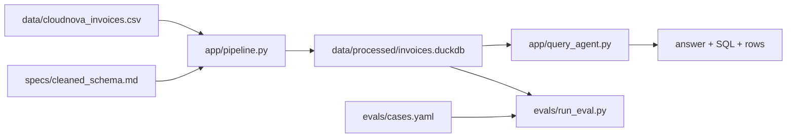

# Architecture

Track B: spec-driven clean/model pipeline + NL→SQL ask layer.

## Data flow

1. **Ingest** — read dirty CSV (~5k rows).
2. **Clean** — normalize plan/status/billing/churn, parse amounts & dates, FX to USD, compute MRR, dedupe by `invoice_id` per `specs/cleaned_schema.md`.
3. **Store** — replace DuckDB table `invoices`.
4. **Ask** — map natural language to SQL (templates first; optional OpenAI NL→SQL), execute read-only, return answer + SQL + sample rows.
5. **Eval** — run fixed SQL cases against the same store; no LLM required in CI.

## Trust boundaries

- Raw CSV is untrusted / dirty.
- Cleaned table is the only surface the query agent may read.
- SQL guardrails reject non-SELECT statements when using the LLM path.
