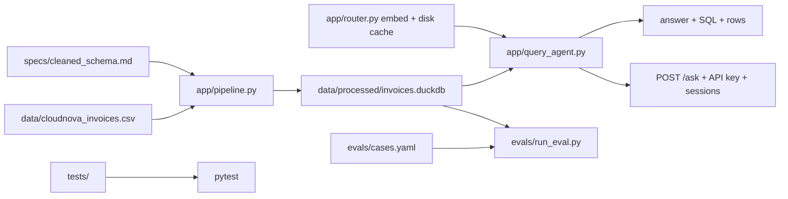

# Architecture

## Ask routing

1. **Embedding** (if keyed) — cosine vs cached template centroids; require threshold + margin.
2. **LLM SQL** — optional multi-turn history from REPL / API session.
3. **Offline** — keyword scores + exemplar token overlap.

## Trust boundaries

- Cleaned DuckDB is the only query surface.
- HTTP auth optional via `CLOUDNOVA_API_KEY`.
- Sessions are process-local memory (demo-grade).
