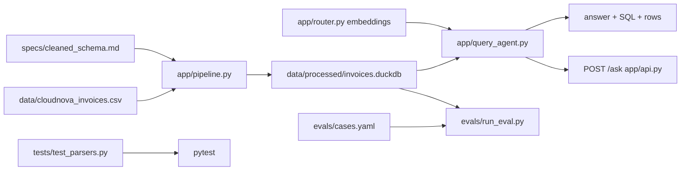

# Architecture

Track B: spec-driven clean/model pipeline + routed NL→SQL ask layer + thin HTTP API.

## Data flow

1. **Ingest** — read dirty CSV (~5k rows).
2. **Clean** — normalize categories, parse amounts & dates (day-first + month-first alt), FX to USD, MRR, dedupe; persist near-dup losers.
3. **Store** — DuckDB `invoices` (+ `invoice_dedup_dropped`).
4. **Route / ask** — with API key: embedding intent → LLM SQL → template fallback; offline: scored templates. Execute read-only SQL.
5. **API** — FastAPI `POST /ask` wraps the same `ask()` function.
6. **Eval / tests** — fixed SQL cases + Hypothesis property tests on parsers (no live LLM in CI).

## Trust boundaries

- Raw CSV is untrusted / dirty.
- Cleaned table is the only surface the query agent may read.
- SQL guardrails reject non-SELECT statements on the LLM path.
- HTTP `question` is length-capped; no auth (local demo only).
